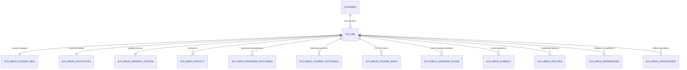
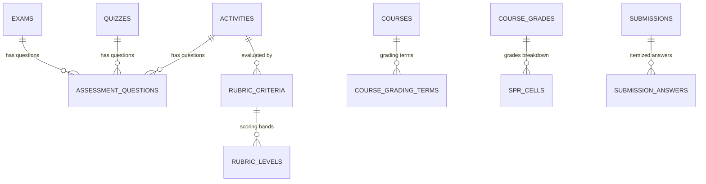

# Database Relational Normalization & Likha ERP File Storage Design

**Date:** 2026-10-13  
**Status:** Approved  
**Author:** AI Agent & Jayvee (Lead Architect)  
**System:** GABAY LMS Prototype with Likha ERP Backend (`https://gabay.zyberlab.com`)

---

## 1. Executive Summary

This specification defines the complete relational normalization of all collections, tables, and entities in the GABAY LMS backend, and links all file and image upload features directly to Likha ERP Directus native file storage (`directus_files` / `/files`).

### Objectives
1. **Eliminate All Raw JSON Blobs (3NF Relational Normalization):**
   - Normalize every section of the course syllabus into dedicated relational child collections.
   - Normalize assessment questions, rubrics, and answer keys out of raw JSON fields into dedicated relational entities.
   - Normalize SPR cells, grade components, and grading term release states.
   - Normalize submission itemized answers and rubric evaluations.
2. **Centralize File & Image Management in Likha ERP:**
   - Eliminate local filesystem disk uploads (`uploads/` directory).
   - Bridge all LMS file and image uploads (course cover images, activity attachments, student submissions, syllabus documents, course files, and user avatars) to Likha ERP Directus `POST /files`.
   - Store the permanent Directus file UUIDs in relational foreign keys and serve assets via `${LIKHA_URL}/assets/:id`.
3. **Preserve Client DTO Contracts (Zero Breaking Changes):**
   - The Express API and Likha repositories will translate between normalized relational child collections and the existing client interface models, ensuring all 60 client Vitest suites pass without regression.

---

## 2. Complete Relational Data Model

### 2.1 Course Syllabus Relational Normalization

Instead of storing serialized JSON in `courses.syllabus` and `syllabi.content`, each section of the syllabus is stored as a relational collection in Likha ERP and mirrored in the backend:



#### Collections & Entities:
1. **`syllabi`** (Revision Root):
   - `id`: String (UUID)
   - `course_id`: String (FK to `courses.id`)
   - `version`: Integer
   - `status`: String (`draft` | `submitted` | `approved` | `published`)
   - `created_by_id`: String (FK to `directus_users.id`)
   - `published_by_id`: String (Nullable FK to `directus_users.id`)
   - `created_at`: DateTime
   - `published_at`: DateTime (Nullable)

2. **`syllabus_course_info`**:
   - `syllabus_id`: String (PK / FK to `syllabi.id`)
   - `course_code`: String
   - `course_title`: String
   - `credits`: Integer
   - `lecture_hours`: Integer
   - `lab_hours`: Integer
   - `prerequisites`: String
   - `semester`: String
   - `academic_year`: String
   - `rationale_description`: Text

3. **`syllabus_institution`**:
   - `syllabus_id`: String (PK / FK to `syllabi.id`)
   - `university_name`: String
   - `campus_name`: String
   - `college_name`: String
   - `department_name`: String
   - `vision`: Text
   - `mission`: Text
   - `goals`: Text

4. **`syllabus_faculty`**:
   - `id`: String (UUID)
   - `syllabus_id`: String (FK to `syllabi.id`)
   - `faculty_user_id`: String (Nullable FK to `directus_users.id`)
   - `faculty_name`: String
   - `email`: String
   - `consultation_hours`: String
   - `office_room`: String
   - `order`: Integer

5. **`syllabus_program_outcomes`** & **`syllabus_course_outcomes`**:
   - `id`: String (UUID)
   - `syllabus_id`: String (FK to `syllabi.id`)
   - `code`: String (e.g. `PO1`, `CO1`)
   - `statement`: Text
   - `order`: Integer

6. **`syllabus_course_maps`**:
   - `id`: String (UUID)
   - `syllabus_id`: String (FK to `syllabi.id`)
   - `course_outcome_code`: String
   - `program_outcome_code`: String
   - `level`: String (`I` | `E` | `D`)

7. **`syllabus_learning_plans`**:
   - `id`: String (UUID)
   - `syllabus_id`: String (FK to `syllabi.id`)
   - `unit_no`: Integer
   - `time_allotment_weeks`: String
   - `intended_learning_outcome`: Text
   - `topic_content`: Text
   - `teaching_activities`: Text
   - `assessment_tasks`: Text
   - `learning_resources`: Text
   - `order`: Integer

8. **`syllabus_grading_systems`**:
   - `syllabus_id`: String (PK / FK to `syllabi.id`)
   - `lecture_weight`: Float
   - `lab_weight`: Float
   - `term_formula`: String
   - `passing_grade`: Float
   - `components_summary`: Text

9. **`syllabus_rubrics`** & **`syllabus_rubric_criteria`**:
   - `syllabus_rubrics`: `id`, `syllabus_id` (FK), `title`, `description`, `rubric_type`.
   - `syllabus_rubric_criteria`: `id`, `rubric_id` (FK), `criterion`, `description`, `max_points`, `order`.

10. **`syllabus_policies`**, **`syllabus_references`**, **`syllabus_signatories`**:
    - Relational child collections linked to `syllabus_id`.

---

### 2.2 Assessments, Questions, Rubrics & SPR Normalization



1. **`assessment_questions`**:
   - `id`: String (UUID)
   - `activity_id`: String (Nullable FK to `activities.id`)
   - `quiz_id`: String (Nullable FK to `quizzes.id`)
   - `exam_id`: String (Nullable FK to `exams.id`)
   - `question_text`: Text
   - `question_type`: String (`multiple_choice` | `essay` | `code` | `short_answer`)
   - `points`: Float
   - `correct_answer`: Text (Nullable)
   - `options_json`: Text (Structured JSON string for MC choices)
   - `order`: Integer

2. **`rubric_criteria` & `rubric_levels`**:
   - `rubric_criteria`: `id`, `activity_id` (FK), `title`, `description`, `max_points`, `order`.
   - `rubric_levels`: `id`, `criterion_id` (FK), `title`, `description`, `points`.

3. **`course_grading_terms`**:
   - `id`: String (UUID)
   - `course_id`: String (FK to `courses.id`)
   - `term`: String (`prelim` | `midterm` | `finals`)
   - `is_released`: Boolean
   - `order`: Integer

4. **`spr_cells`**:
   - `id`: String (UUID)
   - `course_grade_id`: String (FK to `course_grades.id`)
   - `student_id`: String (FK to `directus_users.id`)
   - `course_id`: String (FK to `courses.id`)
   - `term`: String (`midterm` | `final`)
   - `component_key`: String (e.g. `q1`, `mtExam`)
   - `score`: Float

5. **`submission_answers`**:
   - `id`: String (UUID)
   - `submission_id`: String (FK to `submissions.id`)
   - `question_id`: String (FK to `assessment_questions.id`)
   - `student_answer`: Text
   - `awarded_points`: Float (Nullable)
   - `feedback`: Text (Nullable)

---

## 3. Likha ERP Directus Native File & Image Management

### 3.1 Directus File Service Bridge
Directus exposes native file management at `${LIKHA_URL}/files` with the `directus_files` system collection:

```
POST https://gabay.zyberlab.com/files
Headers:
  Authorization: Bearer <Admin_Token>
Body:
  multipart/form-data:
    file: <Blob>
    title: <String>
    folder: <Nullable UUID>
```

Directus automatically generates image thumbnails, calculates byte sizes, extracts MIME types, and assigns a permanent UUID. Assets are retrieved at:
`${LIKHA_URL}/assets/${fileId}`

### 3.2 Relational Entity Linking
1. **Course Cover Image:**
   - Field `image_file_id` in `courses` referencing `directus_files.id`.
   - URL resolved dynamically to `${LIKHA_URL}/assets/${image_file_id}`.
2. **Activity & Assignment Files:**
   - Field `attachment_file_id` in `activities` referencing `directus_files.id`.
3. **Student Submissions:**
   - Field `submission_file_id` in `submissions` referencing `directus_files.id`.
4. **User Avatars & Profile Banners:**
   - Field `avatar_file_id` and `banner_file_id` in `directus_users` referencing `directus_files.id`.
5. **Course Files & Library:**
   - `course_files.directus_file_id` referencing `directus_files.id`.
6. **Syllabus Uploaded Source Documents:**
   - `syllabus_source_documents.directus_file_id` referencing `directus_files.id`.

---

## 4. Migration & Backward-Compatibility Strategy

1. **Idempotent Collection Creation:**
   - A dedicated migration script (`server/src/likha/migrations/initNormalizedSchema.ts`) verifies and creates all missing collections and fields via the Directus API.
2. **Data Unpacking Migration:**
   - For any existing records in `courses`, `activities`, `quizzes`, `course_grades`, and `syllabi`:
     - Unpack legacy JSON into the respective child collections (`assessment_questions`, `rubric_criteria`, `spr_cells`, `syllabus_*`).
     - Retain legacy JSON columns during rollout for fallback resilience, but treat normalized child collections as the single source of truth.
3. **Repository Updates:**
   - Update `server/src/likha/repositories/` (`syllabiRepo.ts`, `assessmentsRepo.ts`, `gradesRepo.ts`, `coursesRepo.ts`, `filesRepo.ts`) to query and persist child rows relationally while returning standard LMS shapes to the frontend.

---

## 5. Verification Plan

1. **Directus Schema Verification:** Query `/collections` and `/fields` to assert all child collections and relations exist.
2. **Data Normalization Verification:** Verify that creating a syllabus, activity with questions, and course grades writes individual relational rows into Likha ERP.
3. **File Upload Verification:** Upload an image and a PDF via the LMS API and verify they appear in Likha ERP `/files` and load from `/assets/:id`.
4. **Automated Test Suites:**
   - Run Client Vitest: Ensure all 60 test suites (320 tests) pass.
   - Run Server Vitest: Ensure core API suites pass.
5. **Browser End-to-End Verification:**
   - Verify Syllabus rendering from normalized relational entities.
   - Verify Assessments creation and question viewing.
   - Verify File upload and preview in browser.
