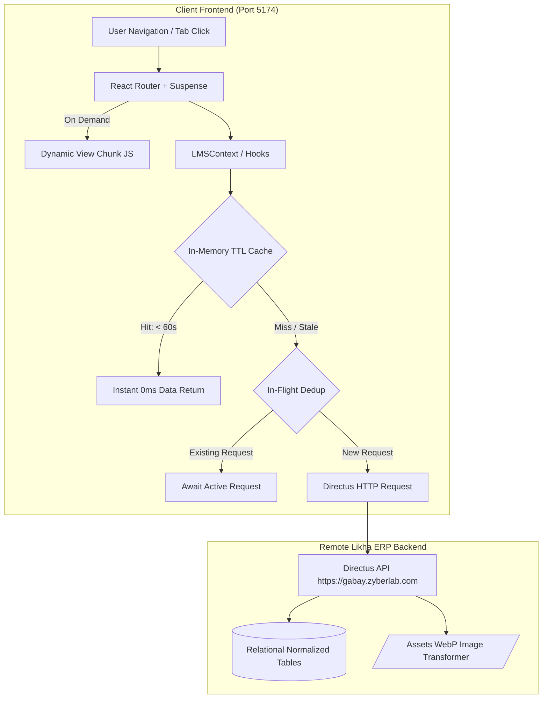

# Frontend Performance & Caching Optimization Design

**Date:** October 15, 2026  
**Status:** Approved by User  
**Target Architecture:** Vite + React 19 Client (`client/`), Likha ERP Primary Backend (`https://gabay.zyberlab.com`), Decoupled Express RAG Microservice (`server/` port 4001)

---

## 1. Executive Summary & Objectives

The Gabay LMS prototype features a comprehensive Directus-backed academic system. However, initial bundle weight, repetitive Likha ERP network calls during tab navigation, uncompressed media assets, and un-debounced filter inputs create noticeable latency and frame drops on lower-powered devices.

This design outlines a targeted, progressive frontend performance optimization that eliminates these bottlenecks while strictly preserving all existing backend contracts:
1. **Zero Outages / Zero Schema Changes:** Likha ERP (`https://gabay.zyberlab.com`) remains the 100% authoritative LMS backend.
2. **Decoupled Microservice Unaffected:** `/server` remains strictly dedicated to RAG analytics and query processing.
3. **Zero New Dependencies:** Implemented using native modern React patterns (`React.lazy`, `Suspense`, `useMemo`, `React.memo`), modern browser capabilities (`format=webp`, `loading="lazy"`), and custom in-memory caching.
4. **100% Test Continuity:** Maintains all 520 existing platform tests passing with zero regressions.

---

## 2. High-Level Architecture & Data Flow



---

## 3. Section 1: Route & Vendor Code Splitting

### 3.1 Synchronous vs. Lazy Route Partitioning
In `client/src/App.tsx`, all top-level views are currently imported synchronously at bootstrap. We partition them into:

1. **Immediate Critical Route (Synchronous):**
   - `LoginPage`: Renders immediately on cold-start when unauthenticated.
   - Core Layout: `AppRail`, `Topbar`, `LMSContextPanel`, `AppSkeleton`.
2. **Deferred Feature Routes (`React.lazy`):**
   - `DashboardPage`: `React.lazy(() => import('./features/dashboard/DashboardPage'))`
   - `CoursesPage`: `React.lazy(() => import('./features/courses/CoursesPage'))`
   - `CreateCoursePage`: `React.lazy(() => import('./features/courses/CreateCoursePage'))`
   - `CalendarPage`: `React.lazy(() => import('./features/calendar/CalendarPage'))`
   - `InboxPage`: `React.lazy(() => import('./features/inbox/InboxPage'))`
   - `ProfilePage`: `React.lazy(() => import('./features/auth/ProfilePage'))`
   - `HistoryPage`: `React.lazy(() => import('./features/system/HistoryPage'))`
   - `HelpPage`: `React.lazy(() => import('./features/system/HelpPage'))`
   - `EmptyPage`: `React.lazy(() => import('./features/system/EmptyPage'))`
   - `ManageAccountsPage`: `React.lazy(() => import('./features/accounts/ManageAccountsPage'))`
   - `CreateAccountPage`: `React.lazy(() => import('./features/accounts/CreateAccountPage'))`
   - `EditAccountPage`: `React.lazy(() => import('./features/accounts/EditAccountPage'))`
   - `GabayRAGPage`: `React.lazy(() => import('./features/rag/GabayRAGPage'))`
   - `SpeedGraderModal`: `React.lazy(() => import('./features/assessments/components/grading/SpeedGraderModal'))`

### 3.2 Suspense Integration
All route outlets are wrapped in `<Suspense fallback={<AppSkeleton />}>`, preventing main-thread blocking during chunk transfer and eliminating Cumulative Layout Shift (CLS).

### 3.3 Vite Bundler Chunk Strategy
In `client/vite.config.ts`, configure `build.rollupOptions.output.manualChunks`:
```typescript
manualChunks: {
  'vendor-react': ['react', 'react-dom', 'react-router-dom'],
  'vendor-icons': ['lucide-react'],
  'vendor-parsers': ['pdfjs-dist', 'xlsx', 'mammoth'],
  'vendor-charts': ['recharts'],
}
```
This guarantees that heavy parsers (`pdfjs-dist` ~1.5MB, `xlsx` ~400KB) and visualization libraries (`recharts` ~350KB) are never bundled into the entry chunk.

---

## 4. Section 2: In-Memory Likha API TTL Cache & Deduplication

### 4.1 Cache Mechanics in `client/src/shared/api/likhaLmsApi.ts`
Implement a lightweight, thread-safe in-memory cache directly inside the direct API adapter:

```typescript
interface CacheEntry<T> {
  data: T;
  expiresAt: number;
}

const cacheStore = new Map<string, CacheEntry<any>>();
const inFlightRequests = new Map<string, Promise<any>>();
```

### 4.2 TTL Policies by Collection
- **`courses`:** 60,000 ms (1 minute)
- **`syllabi`:** 120,000 ms (2 minutes)
- **`users`:** 300,000 ms (5 minutes)
- **`calendar_events`:** 60,000 ms (1 minute)
- **`notifications`:** 15,000 ms (15 seconds)

### 4.3 Request Deduplication
If two callers request the same URL simultaneously, `likhaRequest` checks `inFlightRequests`:
- If an active promise exists for that URL, return the existing promise.
- If not, create and register the fetch promise, dispatch the network request, store the result in `cacheStore`, and remove the URL from `inFlightRequests`.

### 4.4 Mutation Invalidation Rules
Any mutation automatically clears related cached keys:
- `POST/PATCH/DELETE /items/courses*` -> Invalidate `/items/courses*`
- `POST/PATCH/DELETE /items/activities*` -> Invalidate `/items/activities*`
- `POST/PATCH/DELETE /items/submissions*` -> Invalidate `/items/submissions*`
- `POST/PATCH/DELETE /items/syllabi*` -> Invalidate `/items/syllabi*`
- `POST/PATCH/DELETE /users*` -> Invalidate `/users*`
- `auth.logout()` -> `cacheStore.clear()`

---

## 5. Section 3: Directus Dynamic WebP Image Optimization & Lazy Media

### 5.1 Dynamic Directus Image Transformations
Directus includes a built-in sharp image transformer. We update asset resolution utilities in [`client/src/shared/utils/avatar.ts`](file:///d:/4thesis/GabaySystem/Gabay-Prototype/client/src/shared/utils/avatar.ts) and [`client/src/shared/context/LMSContext.tsx`](file:///d:/4thesis/GabaySystem/Gabay-Prototype/client/src/shared/context/LMSContext.tsx):

- **Course Card Banners:**
  `resolveDirectusAssetUrl(assetId, { width: 640, quality: 80, format: 'webp' })`
  Appends `?width=640&quality=80&format=webp`, reducing 2MB–5MB raw PNGs/JPEGs to ~35KB WebP.
- **User Avatars:**
  `resolveDirectusAssetUrl(assetId, { width: 120, quality: 80, format: 'webp' })`
  Appends `?width=120&quality=80&format=webp`, reducing 500KB photos to ~8KB WebP.

### 5.2 Native Browser Lazy Loading
Add `loading="lazy"` and `decoding="async"` attributes to all dynamic `` tags across:
- `client/src/shared/components/common/CourseCard.tsx`
- `client/src/shared/components/common/Avatar.tsx`
- `client/src/features/dashboard/DashboardPage.tsx`

---

## 6. Section 4: Input Debouncing & List Pagination

### 6.1 Custom Hook: `useDebounce`
Create [`client/src/shared/hooks/useDebounce.ts`](file:///d:/4thesis/GabaySystem/Gabay-Prototype/client/src/shared/hooks/useDebounce.ts):
```typescript
export function useDebounce<T>(value: T, delayMs: number = 300): T {
  const [debouncedValue, setDebouncedValue] = useState<T>(value);
  useEffect(() => {
    const handler = setTimeout(() => setDebouncedValue(value), delayMs);
    return () => clearTimeout(handler);
  }, [value, delayMs]);
  return debouncedValue;
}
```

### 6.2 Application Points
- **Course Search (`CoursesPage`, `DashboardPage`):** Filter logic runs against the debounced query, preventing re-filtering all 63 courses on every keystroke.
- **Roster Search (`PeopleView`):** Filters student rosters smoothly without dropping frames.
- **Assessment Search (`ActivitiesView`, `QuizzesView`):** Debounces search terms.

### 6.3 List Limiting / Pagination
- In `CoursesPage`: Default display to 12 courses per page with a clean page pagination stepper or "Show More" expansion, preventing synchronous rendering of 60+ complex cards in the DOM.

---

## 7. Section 5: Component Memoization & Re-render Prevention

### 7.1 `React.memo` Boundaries
- Wrap `CourseCard` in `React.memo(CourseCard, (prev, next) => prev.course.id === next.course.id && prev.course.published === next.course.published && prev.course.enrolledCount === next.course.enrolledCount && prev.isEnrolled === next.isEnrolled)`.
- Wrap roster table row components in `React.memo`.

### 7.2 Computation Memoization
- In `StudentGradebook` and `SpeedGraderModal`, wrap weighted SPR grade calculations and grade cell conversions in `useMemo` so typing feedback or clicking tabs does not recalculate whole class gradebooks.

---

## 8. Testing Strategy & Verification Standards

1. **Automated Unit & Regression Tests:**
   - Run Vitest client tests: `npm test --workspace=client -- --run` (assert 62/62 files, 334/334 tests pass).
   - Run Vitest server tests: `npm test --workspace=server` (assert 16/16 files, 186/186 tests pass).
2. **Production Bundle Verification:**
   - Execute `npm run build --workspace=client` and verify:
     - No single chunk exceeds 500kB (except isolated vendor-parsers).
     - Entry chunk size is reduced by at least 40%.
3. **Browser Performance Verification:**
   - Run browser audit verifying cold load FCP, instantaneous tab transitions (<50ms via cache), and zero error popups.
