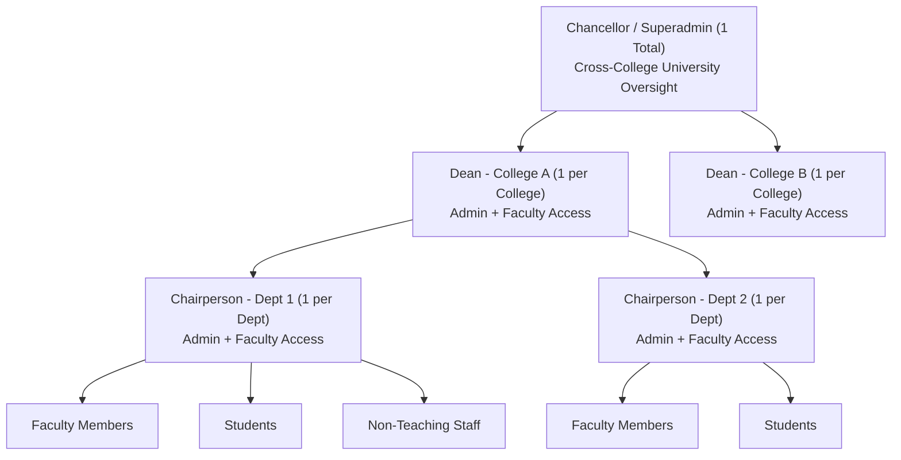
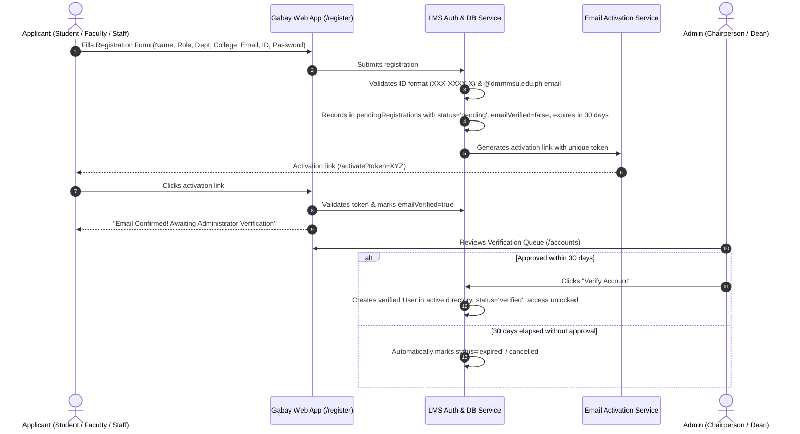

# Multi-College RBAC, Self-Registration, and Verification Workflow Design

**Date:** 2026-10-17  
**Status:** Approved by Engineering Review (Calls settled)  
**Target Architecture:** Gabay LMS (React 19 Frontend + Vite + Tailwind CSS + Lucide Icons + Likha ERP Directus Data Layer / Local State Persistence)

---

## 1. Intent & The Why

Gabay LMS was originally prototyped with hardcoded assumptions tied exclusively to the "College of Computer Science" and a monolithic `admin` role that could perform all operations (including direct account provisioning) across the application. 

This design expands Gabay LMS into an institution-grade, multi-college platform catering to the full university structure:
1. **Dynamic Multi-College & Department Hierarchy:** Accommodating multiple colleges and diverse academic departments without hardcoded limits.
2. **Strict Single-Seat Role Hierarchy & Delegation:** Supporting exactly one Chancellor (Superadmin), exactly one Dean per college, and exactly one Chairperson per department, with a formal leadership succession mechanism.
3. **Dual Role Capabilities:** Enabling Deans and Chairpersons to access administrative workflows while retaining standard Faculty teaching tools (courses, syllabi, grading).
4. **Universal Self-Registration:** Enabling all users (Students, Faculty, Staff) to register themselves, verify their institutional email via an activation link, and enter a 30-day verification queue.
5. **Administrative Verification & Expiration:** Replacing direct account creation by admins with an approval queue where Chairpersons verify department applicants and Deans verify college applicants, with automatic cancellation after 30 days of inactivity.

---

## 2. Goals, Non-Goals, and Anti-Goals

### Goals
- **Multi-College Usability:** Support dynamic configuration and selection of Colleges and Departments.
- **Strict Role-Based Access Control (RBAC):**
  - **Superadmin (Chancellor):** 1 seat university-wide. Cross-college oversight, college & department setup, appointing initial Deans/Chairs.
  - **Dean (College Admin):** 1 seat per college. College-wide scope, dual admin + faculty workspace, verifies college applicants, designates Dean successor.
  - **Chairperson (Department Admin):** 1 seat per department. Department scope, dual admin + faculty workspace, verifies department applicants, designates Chair successor.
  - **Faculty:** Teaching, syllabus authoring, grading, and course management. No administrative console access.
  - **Staff:** Non-teaching operational access.
  - **Student:** Course enrollment, assessments, grades, syllabus viewing.
- **Leadership Handover / Single-Seat Invariant:** When a Dean or Chair is replaced (by themselves or by the Chancellor), the incoming successor is promoted and the outgoing predecessor steps down to standard Faculty, maintaining exactly 1 active Dean per college and 1 active Chair per department.
- **Public Self-Registration (`/register`):** Collect First Name, Middle Name, Last Name, College, Department, Role (Student, Faculty, Staff), Institutional Email, ID Number (`XXX-XXXX-X`), and Password.
- **Email Activation Simulation:** Generates an activation token and simulated activation email link. Upon visiting `/activate?token=...`, email verification is marked as completed.
- **30-Day Expiration Verification Queue:** In `ManageAccountsPage`, replace the "Create Account" button with a "Verification Queue" showing days remaining (30-day countdown). Requests older than 30 days automatically transition to `cancelled` / `expired`.
- **Scoped Verification Approvals:** Chairs can approve/reject registrations for their department; Deans can approve/reject registrations across any department in their college.

### Non-Goals
- Altering Likha ERP Directus schema via REST API DDL calls (strictly prohibited per AGENTS.md). All client app operations use standard item CRUD and client-side relational projection.
- External SMTP server configuration for live outgoing email deliverability in the local prototype environment; email activation is handled via mock activation tokens, notifications, and an in-app verification dialog/banner.

### Anti-Goals
- Never allow more than one active Dean in a college or more than one active Chair in a department.
- Never grant regular Faculty or Students access to the Account Management administrative console.
- Never allow administrators to manually fabricate accounts without going through registration and email verification.

---

## 3. Builder Calls & Resolved Engineering Invariants

Based on the engineering review check, the following architectural choices have been settled as the builder's calls:

1. **Staging Queue Architecture for Registrations:**
   - Pending applicants are recorded in a dedicated reactive staging store (`pendingRegistrations`) persisted in `LMSContext` / `localStorage`.
   - The user is **not** created in Likha `/users` until an administrator approves their application. This prevents Directus login rejection ambiguities and allows `LMSContext` to intercept unapproved login attempts cleanly on `/login` to display the exact remaining expiration days (e.g. *"Pending Admin Verification: Expires in 24 days"*).
   - Once approved by a Chair or Dean, the account is provisioned into active users (and Directus `/users`), unlocking immediate sign-in.
2. **Course Scoping via Instructor Unit:**
   - Courses inherit their College and Department dynamically from their assigned instructor (`course.instructorId -> instructor.department / collegeId`).
   - This eliminates breaking schema changes to Likha `/items/courses` while naturally giving Deans visibility over all courses taught by college faculty, and Chairpersons visibility over department faculty courses.
3. **Colleges & Departments UI Placement:**
   - Integrated as a dedicated tab ("Academic Structure") inside `ManageAccountsPage`, visible exclusively when `activeRole === 'superadmin'`.
   - Allows the Chancellor to view colleges, create new colleges, add departments, and assign the initial Dean and Chairpersons without adding extra rail icons for other users.
4. **Dual-Role Workspace UX:**
   - Implemented as a **unified navigation model**. Deans and Chairpersons have their administrative controls (`Manage Accounts`) added alongside standard faculty tabs (`Courses`, `Modules`, `Syllabus`, `Assessments`, `Grades`). No disruptive workspace toggling or mode switching is needed.
5. **Initial Seeding & Bootstrap:**
   - Existing admin account `jayveegenetareyes@gmail.com` is initialized as the university Chancellor (`superadmin`).
   - The initial College of Computer Science (CCS) is seeded with its 3 departments (Computer Science, Information Technology, Information Systems), with incumbent demo faculty assigned to their respective units.

---

## 4. Organizational & Role Hierarchy



### Detailed Role Specifications

| Role | Scope | Authority & Capabilities | Leadership Succession |
| :--- | :--- | :--- | :--- |
| **Superadmin (Chancellor)** | University-Wide (All Colleges) | - Create & configure colleges and departments<br>- Appoint/replace Deans and Chairpersons<br>- System-wide user directory & audit logs<br>- System settings & metrics | Exactly 1 seat institution-wide. Appoints successors. |
| **Dean (College Admin)** | Single College (All Departments within) | - Dual View: College Administration + Faculty Workspace<br>- Verify/reject registrations across the college<br>- Appoint/replace department Chairpersons in college<br>- Handover Dean position to another verified faculty | Exactly 1 per college. Stepping down reverts user to regular Faculty. |
| **Chairperson (Department Admin)** | Single Department | - Dual View: Department Administration + Faculty Workspace<br>- Verify/reject registrations for their department<br>- Department curriculum & faculty management<br>- Handover Chair position to another department faculty | Exactly 1 per department. Stepping down reverts user to regular Faculty. |
| **Faculty** | Assigned Courses | - Author modules, syllabi, assessments, grades<br>- View enrolled students<br>- No account management or administrative tabs | N/A |
| **Non-Teaching Staff** | Assigned Office / Dept | - Operational workflows, communications, profile | N/A |
| **Student** | Enrolled Courses | - View courses, take quizzes/exams, submit assignments, view grades | N/A |

---

## 5. Data Model Enhancements

### 5.1 College & Department Definitions
```ts
export interface College {
  id: string;
  name: string;
  code: string; // e.g. "CCS", "CTE", "CE"
  deanId?: string; // User ID of the single active Dean
}

export interface Department {
  id: string;
  collegeId: string;
  name: string;
  code: string; // e.g. "CS", "IT", "IS"
  chairpersonId?: string; // User ID of the single active Chairperson
}
```

### 5.2 Extended User Model
```ts
export type UserRole = 'superadmin' | 'admin' | 'faculty' | 'staff' | 'student';
export type AdminSubrole = 'chancellor' | 'dean' | 'chairperson';
export type VerificationStatus = 'pending' | 'verified' | 'rejected' | 'expired';

export interface User {
  id: string;
  name: string;
  firstName?: string;
  middleName?: string;
  lastName?: string;
  email: string;
  role: UserRole;
  adminSubrole?: AdminSubrole;
  collegeId?: string;
  collegeName?: string;
  department: string;
  title: string;
  studentId?: string; // Formatted XXX-XXXX-X
  avatar: string;
  password?: string;
  
  // Registration & Verification
  verificationStatus: VerificationStatus;
  emailVerified: boolean;
  activationToken?: string;
  registeredAt: string; // ISO date
  verificationExpiresAt: string; // ISO date (registeredAt + 30 days)
  verifiedAt?: string;
  verifiedByUserId?: string;
  
  // LMS relationships
  enrolledCourseIds?: string[];
  courseSections?: Record<string, string>;
  lastVisitedAt?: Record<string, string>;
}

export interface PendingRegistration {
  id: string;
  firstName: string;
  middleName?: string;
  lastName: string;
  fullName: string;
  email: string;
  role: 'student' | 'faculty' | 'staff';
  collegeId: string;
  collegeName: string;
  department: string;
  studentId: string;
  password: string;
  emailVerified: boolean;
  activationToken: string;
  registeredAt: string;
  expiresAt: string; // registeredAt + 30 days
  status: 'pending' | 'verified' | 'rejected' | 'expired';
}
```

---

## 6. Registration & Email Activation Flow



### 6.1 Registration Form (`/register`)
- **Name Breakdown:** First Name (required), Middle Name (optional), Last Name (required).
- **Role Selection:** Radio group or toggle for "Student", "Faculty", or "Non-Teaching Staff".
- **College & Department Selection:** Dynamic dropdowns where selecting a College filters the available Departments.
- **Institutional Email:** Must be a valid institutional email.
- **ID Number:** Masked input strictly following format `XXX-XXXX-X` (e.g., `202-6001-A` or numeric `202-6001-1`).
- **Password & Confirmation:** Secure password input.

### 6.2 Email Activation (`/activate`)
- Navigating to `/activate?token=...` or clicking the link on the registration confirmation modal marks the applicant's email as verified.
- The applicant is notified: *"Your institutional email has been verified. Your account is now in the queue for administrator verification before system access is granted."*
- Unverified users attempting to sign in before email confirmation or admin approval are presented with an explanatory alert indicating their current status (e.g., *"Pending Admin Verification: Expires in 24 days"*).

---

## 7. Account Management & 30-Day Verification Queue

### 7.1 Removal of Direct Creation
- In compliance with Ticket 5, the "Create new account" button in `ManageAccountsPage` is removed.
- Admins can no longer bypass registration to provision arbitrary credentials.

### 7.2 Verification Queue Tab
`ManageAccountsPage` is divided into three primary views:
1. **Active Directory:** List of all verified users, searchable and filterable by College, Department, and Role.
2. **Pending Verifications (Badge with count):** Queue of users who have registered and confirmed their email, awaiting administrative approval.
3. **Academic Structure (Superadmin Only):** Colleges and Departments configuration and Dean/Chair appointment.

### 7.3 30-Day Expiration Timer
- Each item in the verification queue displays:
  - Applicant avatar, full name, email, ID number, role, department, and registration timestamp.
  - **Expiration Badge:** Live countdown (e.g., `"Expires in 22 days"`, `"Expires in 3 days"`).
  - When `Date.now() >= expiresAt`, the record is automatically flagged as `expired` / `cancelled` and moved out of the active queue.
- **Actions:**
  - **Verify / Approve:** Elevates `status` to `'verified'`. Account is provisioned and can now sign in immediately.
  - **Reject / Cancel:** Explicitly dismisses the registration with optional feedback.

### 7.4 Scoped Verification Authority
- **Chairperson:** Sees and verifies pending applicants belonging exclusively to their department.
- **Dean:** Sees and verifies pending applicants belonging to any department within their college.
- **Superadmin (Chancellor):** Full visibility across all colleges.

---

## 8. Single-Seat Leadership Succession (Dean & Chair Handover)

To solve the replacement problem (Ticket 4) while enforcing strict 1-per-unit constraints:
1. **The Handover Modal:**
   - In `ManageAccountsPage` or Profile settings, an incumbent Dean or Chair can click **"Handover Leadership / Designate Successor"**.
   - The Chancellor can also initiate a leadership reassignment for any College or Department.
2. **Successor Selection:**
   - The current leader selects a verified Faculty member from their unit (Department faculty for Chair; College faculty for Dean).
3. **Atomic Succession Execution:**
   - The successor's role is promoted to `admin` with `adminSubrole = 'dean'` or `'chairperson'`.
   - The outgoing leader's role is stepped down to `faculty`.
   - All historical teaching records, courses, evaluations, and syllabi of both parties remain intact.
   - Guaranteed invariant: At no point can two active users hold the Dean seat for College X or the Chair seat for Department Y.

---

## 9. Dual Role Access & Navigation Matrix

| Navigation Item | Superadmin | Dean | Chairperson | Faculty | Staff | Student |
| :--- | :---: | :---: | :---: | :---: | :---: | :---: |
| **Learning Management (Dashboard, Calendar, Inbox)** | Yes | Yes | Yes | Yes | Yes | Yes |
| **Courses & Teaching (Modules, Syllabi, Assessments, SpeedGrader)** | Yes (All) | Yes (College) | Yes (Dept) | Yes (Assigned) | No | Yes (Enrolled) |
| **Manage College Accounts (Verification Queue + Directory)** | Yes (All Colleges) | Yes (Own College) | Yes (Own Dept) | No | No | No |
| **Colleges & Departments Setup (Inside Manage Accounts)** | Yes | No | No | No | No | No |
| **Gabay RAG** | Yes | Yes | Yes | Yes | No | Yes |

---

## 10. Verification Plan & Testing

### Automated Test Suite
- `client/src/features/accounts/ManageAccountsPage.test.tsx`:
  - Verify removal of "Create Account" button for admins.
  - Verify display of Pending Verifications tab and 30-day countdown badge.
  - Verify Chairperson can only view/verify department applicants.
  - Verify Dean can view/verify all college applicants.
  - Verify 30-day auto-cancellation behavior.
- `client/src/features/auth/RegisterPage.test.tsx`:
  - Test registration submission with First, Middle, Last names, College, Department, ID Number, Email, Role.
  - Test ID number regex validation (`XXX-XXXX-X`).
  - Test email activation link and token validation.
- `client/src/shared/context/LMSContext.rbac.test.tsx`:
  - Test leadership succession: promoting successor steps down predecessor to faculty.
  - Test single-seat invariant for Superadmin, Dean, and Chairperson.
  - Test login rejection for unverified/pending accounts.

### Manual Verification Flow
1. Open login page, verify "Register" link exists.
2. Register as a new faculty member under College of Computer Science -> Department of Information Technology.
3. Observe email activation screen/prompt, complete activation.
4. Attempt login before admin approval; confirm blocking message with expiration countdown.
5. Log in as Chairperson of Department of Information Technology; navigate to Manage Accounts -> Verification Queue.
6. Verify the applicant; log out and log in as the newly verified faculty member; confirm successful dashboard access.
7. Perform leadership handover test: Chairperson steps down and promotes another faculty member to Chairperson. Verify roles switch smoothly.
