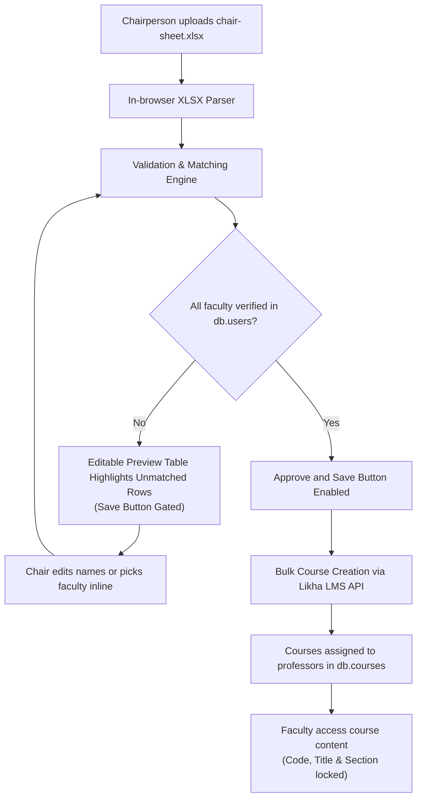

# Chair-Sheet Centralized Course Creation Design

## Intent & The Why

Historically, individual instructors, administrators, or deans could manually create one-off courses, resulting in disorganized course codes, duplicate course offerings, and mismatched section identifiers. 

Under the new academic workflow:
1. **Zero One-Off Course Creation**: No individual user (faculty, dean, chair, admin) has the authority to manually create single course shells from the dashboard or navigation.
2. **Chairperson Authority**: The Chairperson of the academic department is the sole authority permitted to upload the official academic schedule, known as the **Chair-Sheet** (in `.xlsx` format).
3. **Automated Faculty Verification**: The system scans the uploaded sheet and matches each row's instructor against existing faculty members (including faculty, deans, and chairs). Any misspelled or missing faculty is surfaced immediately.
4. **Editable Preview Table**: The Chairperson can inspect and directly adjust names, course codes, titles, or sections on-screen before committing.
5. **Approval & Bulk Generation**: Saving is strictly gated until all instructors are verified. Once approved, the system generates the course shells in Likha ERP, assigned to their respective professors.
6. **Instructor Immutability**: Assigned professors can curate their course (modules, syllabus, announcements, activities, etc.), but core institutional metadata (Course Code, Course Title, Section) remains immutable.
7. **Curriculum Checklist Readiness**: Designed with a modular validation interface so that in the near future, comparison against a curriculum checklist PDF can be plugged in without refactoring.

---

## System Architecture & Data Flow



---

## 1. Authority & Access Rules

- `isChairRole(activeUser, activeRole)`:
  - Chairperson: Permitted to access `/courses/chair-sheet` and see "Upload Chair-Sheet" action on the Dashboard and Program Details.
- Non-Chairpersons:
  - "Create course" button is permanently hidden on the Dashboard and across the navigation.
  - Direct navigation to `/courses/new` or `/courses/chair-sheet` redirects to `/dashboard` with an informative notice: *"Course creation is managed exclusively by the Chairperson via Chair-Sheet."*

---

## 2. File Specification (`chair-sheet.xlsx`)

The file follows the standard format observed in `file-samples/chair-sheet/chair-sheet.xlsx`:
- **Row 1 (Headers)**:
  - Column A: `First Name`
  - Column B: `Middle Name`
  - Column C: `Last Name`
  - Column D: `Course Code`
  - Column E: `Descriptive Title`
  - Column F: `Year and Section`
- **Rows 2+ (Data)**:
  - Trimming required to handle spaces (e.g. `'Charlie '`).
  - Course Code e.g. `'CSCC 103'`.
  - Descriptive Title e.g. `'Object Oriented Programming'`.
  - Year and Section e.g. `'4-E'`.

---

## 3. Faculty Verification Engine

Eligible faculty pool:
- Any user in `db.users` where:
  - `role === 'faculty'` OR
  - `isChairRole(user)` OR
  - `isDeanRole(user)`

Matching rules:
1. **Full Name Match**:
   - Compare `[firstName, middleName, lastName].filter(Boolean).join(' ')` against `user.name` and normalized user profile names (case-insensitive, whitespace-trimmed).
2. **First + Last Name Match**:
   - Compare `firstName` and `lastName` with `user.firstName` and `user.lastName`.
   - If middle name/initial is present, verifies compatibility.
3. **Fuzzy / Typo Suggestions**:
   - If no exact match is found, compute string similarity against the eligible faculty pool.
   - Display suggestion: *"Did you mean [Closest Faculty Name]?"*
   - Status marked as `invalid` until resolved.

---

## 4. Editable Preview Table UI

The preview table contains:
- **Columns**:
  - `#` (Row index)
  - `First Name` (editable input)
  - `Middle Name` (editable input)
  - `Last Name` (editable input)
  - `Course Code` (editable input)
  - `Descriptive Title` (editable input)
  - `Year and Section` (editable input)
  - `Faculty Status` (Status badge + inline faculty selector)
  - `Actions` (Delete row)
- **Live Re-verification**:
  - Typing in any name field instantly re-runs verification for that row.
  - An inline dropdown allows picking an existing faculty directly to auto-fill First, Middle, and Last Name.
- **Save Gate**:
  - If count of invalid rows > 0:
    - Save button is disabled with message: *"Resolve X unmatched faculty members to proceed"*.
    - Banner shows summary of issues.
  - When all rows are valid:
    - Save button is enabled: *"Approve & Create X Courses"*.

---

## 5. Course Generation Pipeline

Upon Chairperson approval:
1. Loop through all verified rows in the table.
2. Determine active school year (from collegiate scope or active year, e.g. `2025-2026`).
3. Determine default academic term (e.g. `1st Sem AY 2025-2026`).
4. Execute `createCourse` in `LMSContext` with:
   - `code`: `row.courseCode.trim().toUpperCase()`
   - `title`: `row.descriptiveTitle.trim()`
   - `section`: `row.yearAndSection.trim()`
   - `instructorId`: `row.matchedUserId`
   - `instructorName`: `row.matchedUserName`
   - `schoolYear`: active collegiate school year
   - `term`: default academic term
   - `published`: true
5. Provide progress indicator during generation.
6. Display completion summary and navigate to Courses or Dashboard.

---

## 6. Course Immutability for Instructors

- In `CoursesPage` and any course presentation views, Course Code, Course Title, and Section are displayed as institutional read-only headers.
- Professors can edit course syllabus, create modules, post announcements, publish assessments, and manage grades, but cannot alter the course code, title, or section.

---

## 7. Curriculum Checklist Extensibility (Future-Ready)

Data structures decouple validation into an extensible interface:
```ts
export interface ChairSheetRowValidation {
  facultyStatus: 'valid' | 'invalid';
  matchedUser?: User | null;
  facultyError?: string;
  // Future Curriculum Checklist hook:
  checklistStatus?: 'valid' | 'invalid' | 'unverified';
  checklistError?: string;
}
```
When checklist validation is implemented later, it will plug into this validator without modifying the table or course creation logic.
