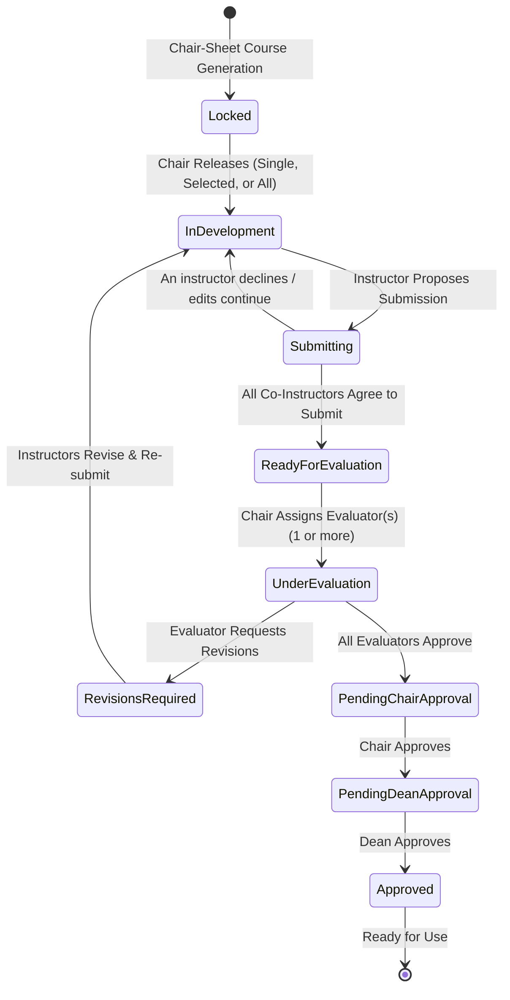

# University Syllabus Lifecycle, Multi-Instructor Collaboration & Multi-Tier Approval Design

## Intent & The Why

In academic institutions like DMMMSU, syllabus authoring must adhere strictly to academic governance rules:
1. **Unregulated Authoring Prevention**: Instructors should not independently author or modify unreleased syllabi until the Department Chairperson has officially released the course curriculum for syllabus development.
2. **Unified Course Syllabi**: When multiple instructors handle different sections of the identical course (same Course Code and Descriptive Title, e.g., CSPC 103 handled across sections 3A, 3B, and 3C), university standards mandate a single unified, coherent syllabus rather than disparate versions per section.
3. **Live Peer Collaboration**: Instructors co-authoring the same syllabus require real-time awareness and synchronization to prevent overwriting each other's work and ensure collaborative alignment on outcomes, grading systems, and learning plans.
4. **Institutional Review & Accountability**: Syllabi cannot be used in classrooms until they successfully navigate a rigorous 3-tier academic quality assurance hierarchy:
   - **Peer Faculty Evaluation** (one or more collegiate evaluators appointed by the Chair).
   - **Department Chairperson Endorsement**.
   - **College Dean Final Institutional Approval**.

---

## Architectural State Machine



---

## 1. Domain Entities & Data Modeling

### 1.1 Course Syllabus Assignment Group (`SyllabusGroup`)
Courses uploaded via Chair-Sheet are grouped by their canonical offering identity:
- `courseCode`: string (e.g., `CSPC 103`)
- `courseTitle`: string (e.g., `Information and Knowledge Management`)
- `schoolYear`: string (e.g., `2026-2027`)
- `semester`: string (e.g., `First`)
- `collegeId`: string
- `departmentId`: string
- `courseIds`: string[] (list of individual section course IDs in `db.courses`)
- `instructorIds`: string[] (unique IDs of all faculty teaching sections of this course)
- `sections`: string[] (e.g., `["BSCS 3A", "BSCS 3B"]`)

### 1.2 Syllabus Development Record (`SyllabusDevelopmentRecord`)
Each `SyllabusGroup` has a corresponding governance record:
```typescript
export type SyllabusLifecycleStatus =
  | 'locked'                     // Course created; instructors cannot develop yet
  | 'in_development'            // Chair released; instructors actively drafting
  | 'submission_in_progress'    // At least one instructor confirmed, waiting for all co-instructors
  | 'ready_for_evaluation'       // All co-instructors agreed; awaiting chair evaluator assignment
  | 'under_evaluation'          // Evaluator(s) assigned; review underway
  | 'revisions_required'        // Evaluator requested revisions; returned to instructors
  | 'evaluator_approved'        // Evaluator(s) approved; awaiting chair approval
  | 'chair_approved'            // Chair approved; awaiting dean approval
  | 'approved';                 // Dean approved; locked & ready for live classroom use

export interface EvaluatorReview {
  evaluatorId: string;
  evaluatorName: string;
  status: 'pending' | 'approved' | 'revisions_requested';
  remarks?: string;
  reviewedAt?: string;
}

export interface SyllabusDevelopmentRecord {
  id: string;                          // Unique group key (e.g., `SYL-CSPC103-2026-1ST`)
  courseCode: string;
  courseTitle: string;
  schoolYear: string;
  semester: string;
  collegeId: string;
  departmentId: string;
  courseIds: string[];
  instructorIds: string[];
  sections: string[];
  status: SyllabusLifecycleStatus;
  releasedAt?: string;
  releasedBy?: string;                 // Chairperson ID
  submissionAgreements: Record<string, boolean>; // instructorId -> agreed
  evaluators: EvaluatorReview[];       // 1 or more assigned evaluators
  chairApprovedAt?: string;
  chairApprovedBy?: string;
  deanApprovedAt?: string;
  deanApprovedBy?: string;
  activeRevisionId?: string;
  syllabusData: OfficialSyllabusData;
  updatedAt: string;
}
```

---

## 2. User Interfaces & Navigation Architecture

### 2.1 Role-Adaptive Hub on `/page1` (`Syllabus Development`)
The top-level route `/page1` acts as a role-adaptive command center:

1. **For Department Chairperson & College Dean**:
   - Primary view defaults to the **Department Syllabus Governance & Monitoring Table**:
     - **Summary Counters**: Total Courses, Locked, In Development, Ready for Evaluation, Under Evaluation, Approved.
     - **Interactive Table Columns**:
       - Multi-select Checkbox (with master header toggle).
       - Course Code & Title.
       - Assigned Instructors (with avatar initials and name).
       - Assigned Sections (badges e.g., `3A`, `3B`).
       - Status Badge (with color-coded indicator and label).
       - Evaluators (avatars/names or "Unassigned" button).
       - Actions:
         - When `locked`: "Release for Development".
         - When `ready_for_evaluation`: "Assign Evaluators".
         - When `evaluator_approved`: "Review & Approve (Chair)".
         - When `chair_approved` (for Dean): "Grant Dean Approval".
         - Always: "View Document / Preview".
     - **Bulk Action Toolbar**: Appears when 1 or more rows are checked:
       - "Release Selected (N) for Development"
       - "Release All Department Courses"

2. **For Faculty Instructors**:
   - Primary view displays **"My Assigned Syllabi"**:
     - Shows only courses where `activeUser.id` is in `instructorIds`.
     - If `locked`: Card displays a locked state with message: *"Syllabus development is locked. Your Department Chairperson has not yet released this course for development."*
     - If `in_development` or `revisions_required`: Displays an action button *"Open Syllabus Studio"* to collaborate on the shared draft.
     - If `submission_in_progress`: Shows the co-instructor agreement tracker with an active *"Confirm Agreement to Submit"* button.
     - If `under_evaluation` / `approved`: Displays status badge and allows read-only viewing or printing.
   - Also displays an **"Evaluations Assigned to Me"** tab/section if the faculty member has been chosen as an evaluator by the Chair.

---

## 3. Real-Time Collaboration & Synchronization Engine

### 3.1 Live Sync Architecture: Browser BroadcastChannel + Likha ERP Platform REST API
Because we interact with Likha ERP solely via its standard platform APIs (without access or modifications to the underlying server codebase):
1. **Cross-Tab / Multi-Window Sync (Browser-Native `BroadcastChannel`)**:
   - `BroadcastChannel` is a standard web browser API that runs entirely on the client side. It requires **zero changes to the Likha ERP server codebase**.
   - When multiple tabs or windows are open (e.g., simulating Instructor A and Instructor B during testing or local multi-account workflows), `BroadcastChannel` provides instant, sub-second typing and presence updates without hitting server rate limits.
2. **Cross-Device Sync (Likha ERP Standard Platform REST API)**:
   - For separate physical machines, live updates are persisted through Likha ERP's existing platform REST API (`/items/syllabi` or course syllabus data).
   - An active collaboration heartbeat checks the latest `updatedAt` / `revisionNo` timestamp every few seconds while the authoring studio is open, pulling updates made by remote co-instructors.
3. **Presence UI & Non-Blocking Merging**:
   - Displays live chips: *"🟢 Prof. Santos (BSCS 3A) is editing Part III (Learning Plan)"*.
   - Section-level updates avoid overwriting active input focus.

---

## 4. Multi-Instructor Submission Consensus & Revision Cycle

1. **Unanimous Submission Gate**:
   - In Step 7 (Review & Finalize), a **Co-Instructor Agreement Panel** shows each instructor's status (`Agreed ✓` or `Pending ⏳`).
   - Only when **100% of assigned instructors** confirm agreement does the syllabus transition to `ready_for_evaluation`.
2. **Revision Reset Semantics**:
   - If an evaluator requests revisions (`revisions_required`), the submission agreements reset to `pending`.
   - After revising, all co-instructors must re-confirm their agreement before the syllabus can be resubmitted.
3. **Multi-Evaluator Re-review**:
   - When multiple evaluators are assigned and revisions are submitted, **all assigned evaluators must re-review and approve** the updated syllabus before it moves to the Department Chairperson.

---

## 5. UI Structure on `/page1` (`Syllabus Development`)

The `/page1` route serves as the unified academic authoring and governance portal:
1. **Chairperson & Dean View**:
   - Defaults to the **Department Syllabus Governance & Monitoring Table**:
     - Course Code, Title, Instructors, Sections, Status Badge, Evaluators, Actions.
     - Multi-select checkboxes + Bulk Action Bar ("Release Selected for Development", "Release All").
     - Evaluator assignment modal (multi-select, scoped to collegiate faculty, excluding course instructors).
     - Chair/Dean review & approval modals.
2. **Faculty Instructor View**:
   - **Primary Tab ("My Assigned Courses")**:
     - Lists all courses assigned to the instructor via Chair-Sheet.
     - Courses waiting for Chair approval show a locked state (*"Pending release by Department Chairperson"*).
     - Released courses provide *"Open Syllabus Studio"* to collaborate on the shared draft.
   - **Secondary Tab ("Personal Sandbox / Templates")**:
     - Allows faculty to experiment, build standalone drafts, or test document uploads (.docx / .pdf) without affecting official university courses.
   - **Evaluator Section ("Assigned for My Evaluation")**:
     - Appears if the faculty member is selected as an evaluator for another department course.

1. In the Syllabus Wizard (Step 7 Review & Finalize), when multiple instructors are attached to the course group:
   - A **Co-Instructor Submission Panel** is rendered:
     - Lists all assigned instructors.
     - Indicates each instructor's agreement state:
       - `Prof. Alice (BSCS 3A)`: Ready to submit (Agreed at 10:15 AM) ✓
       - `Prof. Bob (BSCS 3B)`: Pending review ⏳
   - Instructors can click **"Agree to Submit"** (or withdraw agreement if further edits are made).
2. **Auto-Transition**:
   - When the final co-instructor confirms agreement, the syllabus automatically transitions from `submission_in_progress` to `ready_for_evaluation`.
   - A success notification is shown to the instructors, and the status updates on the Chair's table.

---

## 5. Multi-Tier Evaluation & Approval Protocol

### 5.1 Evaluator Selection by Chair
- Once a syllabus is in `ready_for_evaluation`, the Chair clicks **"Assign Evaluators"**.
- A modal opens with a multi-select search dropdown.
- **Strict Scope Restriction**:
  - Filtered exclusively to users in `db.users` where:
    - `user.collegeId === activeUser.collegeId` (or user's department matches chair's college).
    - `isFacultyRole(user) === true`.
    - `!record.instructorIds.includes(user.id)` (prevents conflict-of-interest self-evaluation).
- Chair selects **one or more evaluators** and clicks "Confirm Assignment".
- Status transitions to `under_evaluation`.

### 5.2 Evaluator Review & Revision Loop
- Assigned evaluators open the syllabus in review mode.
- Evaluator options:
  - **"Approve Syllabus"**: Records the evaluator's approval timestamp.
  - **"Request Revisions"**: Opens a remarks modal requiring actionable feedback (e.g., *"Please update Week 6 assessment tasks to align with SDG 4"*).
- **Consensus Rule**:
  - If **any** evaluator requests revisions, the status immediately returns to `revisions_required`.
  - The evaluator's comments are displayed in a prominent amber revision banner at the top of the Syllabus Creator.
  - Once instructors revise, they re-confirm agreement to re-submit.
  - If **all** assigned evaluators approve, the status transitions to `evaluator_approved`.

### 5.3 Chairperson & Dean Final Approvals
1. **Chairperson Endorsement**:
   - Chairperson reviews the evaluator-approved syllabus.
   - Chair clicks **"Endorse & Forward to Dean"**.
   - Status transitions to `chair_approved`.
2. **Dean Final Authorization**:
   - Dean reviews the syllabus.
   - Dean clicks **"Grant Final Institutional Approval"**.
   - Status transitions to `approved`.
   - The syllabus is marked locked, permanent, and officially ready for live classroom instructional use.

---

## 6. Verification & Pressure Testing Strategy

1. **RBAC & Gate Enforcement**:
   - Verify instructors cannot edit syllabi while status is `locked`.
   - Verify non-chairpersons cannot access the release or evaluator assignment controls.
   - Verify evaluators cannot be selected from outside the college or from the course's own instructors.
2. **Multi-Instructor Live Sync**:
   - Verify simulated two-tab / multi-user session: editing in one tab broadcasts presence and updates to the peer tab.
   - Verify unanimous submission gate: course remains in `submission_in_progress` until 100% of co-instructors agree.
3. **Approval Chain Integrity**:
   - Verify rejection with remarks returns syllabus to `revisions_required`.
   - Verify progression through Evaluators -> Chair -> Dean.
   - Verify client build and test suites pass 100% green.
